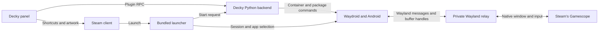

# How Waydroid Manager works

## Find the relevant code

| Area | Responsibilities | Where to look |
| --- | --- | --- |
| Decky panel | App list, actions, progress, and notifications | [`src/`](../src), [RPC types](../src/backend.ts) |
| Steam integration | Live shortcut actions, artwork, and Steam settings | [Steam actions](../src/steam.ts), [artwork](../src/artwork.ts), [library lookup](../py_modules/waydroid_manager/steam.py) |
| Android management | Image setup, package operations, and service control | [`main.py`](../main.py), [backend modules](../py_modules/waydroid_manager) |
| Game Mode runtime | Launch lifetime, Wayland transport, controller, and metrics | [`bin/`](../bin), [runtime modules](../py_modules/waydroid_manager) |

## Follow a launch

1. Steam starts the bundled launcher with the shortcut's session environment. If needed, the launcher asks Decky's backend to start Waydroid through a private, authenticated socket.
2. The first launcher creates a private Wayland connection and starts a shared Android session. Later Steam shortcuts join that session and launch their own Android package.
3. The relay forwards shared buffer handles directly to Gamescope. Each shortcut has a lease, so ending one package leaves the other Android windows running. The session closes after the final lease ends.

## Know what the plugin owns

| Resource | Lifetime |
| --- | --- |
| Android image, apps, and data | Kept until you remove them in the plugin |
| Shortcut preferences and generated artwork | Saved per user. Steam owns the shortcuts, and the plugin tracks generated artwork by its digest. |
| Shared session unit, control and relay sockets, and controller bridge | Created for active Steam shortcuts and cleaned up after the final shortcut ends |
| Android frame overrides | Applied during the launch, then restored |

The plugin uses the platform's existing Waydroid service, Gamescope, and drivers. Native Wayland window selection and direct touch depend on the compositor. Android 13 frame limiting and Play Protect approval depend on Android interfaces specific to that release. Native Steam is the tested configuration. See the [frame cap limitation](features.md#known-issue-with-frame-cap-precision) for the remaining Waydroid driver work.
