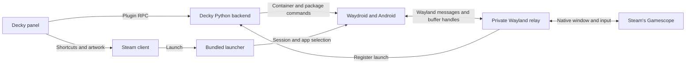

# How Waydroid Manager works

## Find the relevant code

| Area | Responsibilities | Where to look |
| --- | --- | --- |
| Decky panel | App list, actions, progress, and notifications | [`src/`](../src), [RPC types](../src/backend.ts) |
| Steam integration | Live shortcut actions, artwork, and Steam settings | [Steam actions](../src/steam.ts), [artwork](../src/artwork.ts), [library lookup](../py_modules/waydroid_manager/steam.py) |
| Android management | Image setup, package operations, and service control | [`main.py`](../main.py), [backend modules](../py_modules/waydroid_manager) |
| Game Mode runtime | Launch lifetime, Wayland transport, controller, and metrics | [`bin/`](../bin), [runtime modules](../py_modules/waydroid_manager) |
| Launch configuration | Build temporary configuration contents without changing installed files | [Session settings](../py_modules/waydroid_manager/session_settings.py) |
| Runtime overlays | Own temporary mounts, manifests and crash cleanup | [Runtime display lease](../py_modules/waydroid_manager/runtime_display.py) |
| Upgrade recovery | Restore transactions left by older plugin versions | [Overlay recovery](../py_modules/waydroid_manager/legacy_overlay.py), [session recovery](../py_modules/waydroid_manager/legacy_session.py) |
| Image preparation | Validate effective image interfaces and build matching resource overlays | [Payload validation](../py_modules/waydroid_manager/display_payload.py), [resource preparation](../py_modules/waydroid_manager/display_resources.py) |
| Frame limits | Select display cadence and own temporary app policies | [Display modes](../py_modules/waydroid_manager/display_frame_limit.py), [app policies](../py_modules/waydroid_manager/frame_limit.py) |
| Host storage | Discover drives, own private mounts and expose protected document roots | [Storage lifecycle](../py_modules/waydroid_manager/shared_storage.py), [Android provider](../android/storage/src/waydroid/manager/storage) |

## Follow a launch

1. Steam starts the bundled launcher. The relay registers its process and private Wayland socket with the Decky backend, which starts the Waydroid service if needed.
2. The first shortcut starts the shared Android session and waits for Android to
   finish booting and unlock the current user. Further plugin launches join it.
   An unrelated Waydroid session must be closed first.
3. The shared relay forwards buffer handles to Gamescope, with a separate listener
   for the secondary host output. It runs in a Steam application scope so native
   windows have a host app identity. Per-launch registrations control shared
   session and external-display lease counts.
4. Compatible plugin sessions use temporary native display mounts, including
   single-screen launches using the improved frame limiter. Second-screen
   sessions add image-specific resources and socket bindings. A separate guard can clean them up after the
   backend exits. Controller, GPU metrics, and frame-limit adapters attach only
   to the session using the registered socket.
5. The backend launches the requested activity on Android's default display.
   Native display sessions compose complete Android outputs on single-screen and
   dual-screen hosts, avoiding a dependency
   on image-specific task-layer names. Home launches do not expand notifications
   to trigger a screen refresh.
6. The display cap is prepared before the activity starts. After Android confirms
   startup, the limiter applies the app UID policy so its refresh information is
   updated. Steam settings and app lifetime events resend the current target;
   unchanged native caps skip Android queries until the existing policy check.

The shared relay retains the first launch's Steam identity. Joining a session does
not provide independent Steam windows or per-shortcut foreground layout switching.
Companion apps intentionally share their primary shortcut's ownership.

User preferences and artwork cleanup run as the Steam login user. APK and XAPK content goes through Android's package installer, with no need for the backend to stage packages in the user's Android data directory.

Install verification holds a guest input guard before exposing Decky's approval dialog, through completion of the commit. The helper waits on a pipe and restores input on EOF or graceful termination; it adds no polling. Already-disabled input is preserved, and guest identity checks keep cleanup out of a replacement container.

New launches stage their changes under `/run`. The legacy recovery modules only
restore older on-disk transactions before startup; they cannot create new leases.

## Know what the plugin owns

| Resource | Lifetime |
| --- | --- |
| Android image, apps, and data | Kept until you remove them in the plugin |
| Shortcut preferences and generated artwork | Saved per user. Steam owns the shortcuts, and the plugin tracks generated artwork by its digest. |
| Session units, control and relay sockets, and controller bridge | Created for the plugin or launch and cleaned up when it ends |
| Android frame overrides and display policy | Restored on normal shutdown while the original guest is available. Settings changed separately by the user are preserved. |
| Second-screen files and configuration mounts | Staged under `/run`, released after the final launch, and recovered by a separate root guard if the backend disappears. |
| Prepared resources and signing identity | Kept in the plugin's user cache; image, resource and recipe changes invalidate the matching prepared payload. |
| Host document roots and idmapped mounts | Attached only to the owned session. Private mount propagation keeps provider mounts out of the host namespace. |

The plugin uses the platform's existing Waydroid service, Gamescope, DRM leasing and drivers. Native Wayland window selection and direct touch depend on the compositor. Android 13 frame limiting and Play Protect approval use interfaces specific to that release. Native Steam is the tested configuration. See [frame limits](features.md#frame-limits) for native and fallback behavior.

## Build and release ownership

The regular build workflow discovers native profiles, builds or restores native
libraries and private host tools, then packages them with the frontend and Android
helpers. Source dependencies are fetched from pinned upstream revisions into CI
caches. Only the plugin package is a downloadable build artifact.

The release workflow calls that same build with an exact major.minor.patch version,
then publishes its checked ZIP and the matching versioned release notes. Device
preparation compiles only image-specific Android resources; it does not fetch an
Android source tree or install tools into the host OS.
