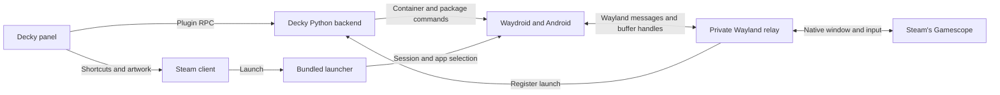

# How Waydroid Manager works

## Find the relevant code

| Area | Responsibilities | Where to look |
| --- | --- | --- |
| Decky panel | App list, actions, progress, and notifications | [`src/`](../src), [RPC types](../src/backend.ts) |
| Steam integration | Live shortcut actions, artwork, and Steam settings | [Steam actions](../src/steam.ts), [artwork](../src/artwork.ts), [library lookup](../py_modules/waydroid_manager/steam.py) |
| Android management | Image setup, package operations, and service control | [`main.py`](../main.py), [backend modules](../py_modules/waydroid_manager) |
| Game Mode runtime | Launch lifetime, Wayland transport, controller, and metrics | [`bin/`](../bin), [runtime modules](../py_modules/waydroid_manager) |

## Follow a launch

1. Steam starts the bundled launcher. The relay registers its process and private Wayland socket with the Decky backend, which starts the Waydroid service if needed.
2. The first shortcut starts the shared Android session and waits for Android to
   finish booting and unlock the current user. Further plugin launches join it.
   An unrelated Waydroid session must be closed first.
3. The shared relay forwards buffer handles to Gamescope, with a separate listener
   for the secondary host output. It runs in a Steam application scope so native
   windows have a host app identity. Per-launch registrations control shared
   session and external-display lease counts.
4. A compatible second-screen session uses temporary mounts for its Android
   payload and socket binding. A separate guard can clean them up after the
   backend exits. Controller, GPU metrics, and frame-limit adapters attach only
   to the session using the registered socket.

User preferences and artwork cleanup run as the Steam login user. APK and XAPK content goes through Android's package installer, with no need for the backend to stage packages in the user's Android data directory.

## Know what the plugin owns

| Resource | Lifetime |
| --- | --- |
| Android image, apps, and data | Kept until you remove them in the plugin |
| Shortcut preferences and generated artwork | Saved per user. Steam owns the shortcuts, and the plugin tracks generated artwork by its digest. |
| Session units, control and relay sockets, and controller bridge | Created for the plugin or launch and cleaned up when it ends |
| Android frame overrides and display policy | Restored on normal shutdown while the original guest is available. Settings changed separately by the user are preserved. |
| Second-screen files and configuration mounts | Staged under `/run`, released after the final launch, and recovered by a separate root guard if the backend disappears. |

The plugin uses the platform's existing Waydroid service, Gamescope, and drivers. Native Wayland window selection and direct touch depend on the compositor. Android 13 frame limiting and Play Protect approval depend on Android interfaces specific to that release. Native Steam is the tested configuration. See the [frame cap limitation](features.md#known-issue-with-frame-cap-precision) for the remaining Waydroid driver work.
